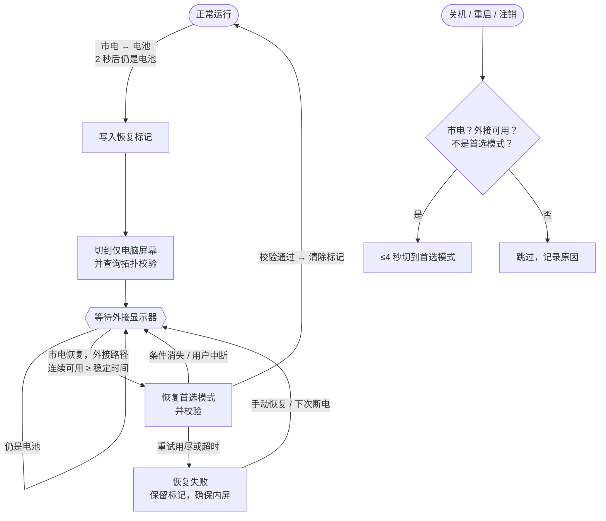

<div align="center">


# PowerGuard Display · 断电护屏

**宿舍断电，自动切回笔记本内屏；来电后，自动恢复外接显示器。**

一个轻量的 Windows 托盘工具：不需要管理员权限、不装驱动、不联网。

[](https://github.com/Runa-Asahi/PowerGuard-Display/releases/latest)
[](https://github.com/Runa-Asahi/PowerGuard-Display/actions/workflows/ci.yml)
[](#许可)
[](https://dotnet.microsoft.com/download/dotnet/10.0)
[](#快速开始)

[下载](#快速开始) · [工作原理](#工作原理) · [设置](#设置) · [常见问题](#常见问题) · [更新记录](docs/CHANGELOG.md) · [设计文档](docs/DESIGN.md)

</div>

---

## 为什么需要它

平时笔记本合盖或只用“仅第二屏幕”。宿舍一断电，外接显示器跟着黑掉，笔记本还开着却**什么都看不见**。PowerGuard Display 会在检测到“市电 → 电池”时立刻切回笔记本内屏；来电、显示器稳定后，再自动切回你习惯的模式。

## ✨ 功能亮点

| | |
| --- | --- |
| ⚡ **断电自动切内屏** | 确认“市电 → 电池”（2 秒防抖）后切到仅电脑屏幕，并重新查询拓扑确认 |
| 🔁 **来电自动恢复** | 市电恢复且 Windows 稳定识别外接显示器（默认 15 秒）后，恢复首选模式；有重试上限和超时 |
| 🔌 **关机前切回首选模式** <sup>v1.2</sup> | 关机 / 重启 / 注销前尽力切回首选模式，让下次开机直接进入外接屏；最多约 4 秒，绝不阻止关机 |
| 💾 **重启也能接着恢复** | 切屏前先原子写入恢复标记，断电关机后再次登录时继续未完成的恢复 |
| 🛡️ **保守、可预期** | 电源未知时不当作断电；启动时仅因电池供电不会切屏；一切切换都以实际拓扑校验为准 |
| 🪶 **轻量无打扰** | 托盘常驻；原生 `SetDisplayConfig` 切屏（失败回退 DisplaySwitch.exe）；任务计划程序登录自启，无需管理员 |

## 快速开始

### 1. 下载

到 [**最新 Release**](https://github.com/Runa-Asahi/PowerGuard-Display/releases/latest) 选择一个包：

| 包 | 大小 | 适合 |
| --- | --- | --- |
| `PowerGuardDisplay-<版本>-win-x64-self-contained.zip` | 约 72 MB | **推荐**。自带 .NET 运行时，解压即用 |
| `PowerGuardDisplay-<版本>-win-x64-framework-dependent.zip` | 约 0.4 MB | 已安装 [.NET 10 Desktop Runtime x64](https://dotnet.microsoft.com/download/dotnet/10.0) 的电脑 |

可用 Release 附带的 `SHA256SUMS.txt` 校验文件。

### 2. 安装与首次配置

1. 把 `PowerGuardDisplay.exe` 放到**固定位置**，例如 `%LOCALAPPDATA%\Programs\PowerGuardDisplay\`（自启动任务记录的是完整路径，移动后需在设置里重新开启一次）。
2. 双击运行。首次运行会打开控制台，之后默认只在托盘运行。
3. 打开 **设置**：
   - **首选显示模式**：平时用“仅第二屏幕”就选 **仅外接显示器**（默认）。
   - 开启 **当前用户登录后自动启动**，断电关机后第二天登录也能继续恢复。
4. 在控制台依次点 **立即切回笔记本内屏**、**尝试恢复首选显示模式**，确认两种切换在你的电脑上都生效。

> [!TIP]
> 关闭主窗口只会隐藏到托盘，后台保护继续。真正退出请用托盘菜单 **退出程序**。再次运行 exe 会打开已有实例的窗口。

### 托盘图标


**蓝** 正常 · **橙** 流程进行中（断电保护 / 等待恢复）· **红** 恢复失败或监听未运行 · **灰** 已暂停（可选“暂停 1 小时”，到时自动恢复）

## 工作原理



- **只认“市电 → 电池”**：笔记本没接电源，或电池耗尽直接关机时，无法触发保护。
- **“检测到路径” ≠ “显示器亮了”**：程序只能知道 Windows 是否认为外接目标可用。有些显示器断电后仍保留 EDID 信号，所以只在**市电恢复后**才开始稳定计时。
- **关机前恢复只在安全时执行**：接市电、检测到外接显示路径、当前不是首选模式、没有暂停、不在恢复失败或切屏过程中。重启管理器（安装更新）只要求关闭程序时不会触发。恢复标记不改动，下次开机如果已是首选模式，会直接确认并清除标记。

状态机、电源和显示检测、自启动任务等细节见 [docs/DESIGN.md](docs/DESIGN.md)。

## 设置

设置页可以修改：

| 设置 | 默认 | 说明 |
| --- | --- | --- |
| 首选显示模式 | 仅外接显示器 | 恢复和关机前切换的目标：仅笔记本屏幕 / 仅外接显示器 / 扩展 / 复制 |
| 断电时自动切回内屏 | 开 | 关闭后只记录、不切屏 |
| 来电后自动恢复 | 开 | 关闭后需要手动点“尝试恢复首选显示模式” |
| 关机 / 重启 / 注销前切回首选模式 | 开 | 仅在安全条件满足时执行，最多约 4 秒 |
| 稳定等待时间 | 15 秒 | 外接路径连续可用多久才恢复（3–600） |
| 恢复超时 | 30 分钟 | 市电恢复后多久仍未成功就停止（1–1440） |
| 重试间隔 / 最多重试 | 20 秒 / 3 次 | 间隔 5–3600 秒，重试 0–10 次；总尝试次数 = 1 + 最多重试 |
| 登录后自动启动 | 关 | 任务计划程序，仅当前用户、无需管理员 |
| 系统通知 / 保留日志 | 开 / 开 | 日志保留 14 天；关闭后只保留当天 |

<details>
<summary><b>高级：只能在 <code>settings.json</code> 中修改的项</b></summary>

| 键 | 默认 | 说明 |
| --- | --- | --- |
| `SwitchMethod` | `Auto` | `Auto` 先原生 SetDisplayConfig、失败回退；`Native`；`DisplaySwitch` |
| `DisplaySwitchArgStyle` | `Auto` | 回退到 DisplaySwitch.exe 时的参数风格：`Auto`（Win11 用数字）/ `Slash` / `Numeric` |
| `VerifyDelaySeconds` | `4` | 切换后等待多久再校验（1–30） |
| `PowerLossConfirmSeconds` | `2` | 断电防抖时间（0–30） |

数据目录：`%LOCALAPPDATA%\PowerGuardDisplay\`
- `settings.json`：配置（旧版本会自动迁移）
- `recovery-state.json`：未完成的恢复标记（文件存在就表示有未完成的流程）
- `logs\powerguard-yyyyMMdd.log`：JSON Lines 日志，单文件 2 MB 滚动

</details>

## 常见问题

<details>
<summary><b>升级后界面还是显示旧版本号 / 看不到新功能</b></summary>

一般是旧版本还在托盘里运行。v1.2.0 首次发布的包和更早的版本中，再次运行 exe 只会唤醒已有实例的窗口，所以看到的其实是旧程序。现在的版本会检测到“另一个版本正在运行”，并询问是否替换。如果仍有问题，从托盘菜单 **退出程序**，在任务管理器确认没有 `PowerGuardDisplay.exe` 后再运行新版本。左下角版本号带有构建提交，例如 `v1.2.0 (abc1234)`。开启了登录自启动的话，新版本启动时会把任务改为指向当前 exe。
</details>

<details>
<summary><b>切屏后内外屏都没有画面</b></summary>

按 **Win+P** 选“仅电脑屏幕”；或按 **Win+Ctrl+Shift+B** 重置显卡驱动；或从托盘菜单点 **切回笔记本内屏**。
</details>

<details>
<summary><b>关机后下次开机仍在内屏</b></summary>

看日志里“关机前恢复”那几行的跳过原因（例如当时是电池供电、没检测到外接显示器）。Windows 快速启动、显卡驱动在开机时重新检测显示器，也可能让它不生效。这个功能是“尽力而为”。
</details>

<details>
<summary><b>日志显示 “SetDisplayConfig 返回 …”</b></summary>

显卡驱动拒绝了原生切换，程序会自动回退 DisplaySwitch.exe。想一直用 DisplaySwitch，把 `settings.json` 的 `"SwitchMethod"` 改为 `"DisplaySwitch"`。
</details>

<details>
<summary><b>切换时只弹出 Windows 的“投影”菜单（仅回退到 DisplaySwitch 时）</b></summary>

Windows 11 22H2 起 DisplaySwitch.exe 改用数字参数。程序会在 15 秒后关掉菜单。可以把 `"DisplaySwitchArgStyle"` 改为 `"Numeric"` 或 `"Slash"` 后重启程序。
</details>

<details>
<summary><b>控制台显示“恢复失败”</b></summary>

看“最近事件”和运行日志。确认显示器已通电、HDMI 已插好，在 Windows“设置 > 系统 > 屏幕”点“检测”，再点 **尝试恢复首选显示模式**。
</details>

<details>
<summary><b>外接显示器断电了，却仍显示“已识别”</b></summary>

有些显示器断电后仍保留 EDID / 热插拔信号。程序只在市电恢复后才开始稳定计时，一般不受影响；如果恢复得太早，把“稳定等待时间”调大。
</details>

<details>
<summary><b>自启动开启失败 / 托盘图标不见了 / 想重置</b></summary>

- **自启动**：界面会显示 schtasks 的错误。Win+R 输入 `taskschd.msc` 查看 `PowerGuardDisplay` 任务，或运行 `schtasks /Query /TN PowerGuardDisplay /V /FO LIST`。公司 / 学校电脑的组策略可能禁止创建任务。
- **托盘图标**：可能在任务栏溢出区；再次运行 exe 会打开已有窗口。
- **配置损坏**：会改名备份为 `settings.json.corrupt-时间戳` 并使用默认值；文件被占用时不会被覆盖。
- **重置**：从托盘退出，删除 `%LOCALAPPDATA%\PowerGuardDisplay\`，再在设置页重新开启自启动。
</details>

## 实机验证

自动化测试在 GitHub Actions（windows-latest）上运行，覆盖状态机、持久化、关机前决策、拓扑推导和并发，**但 CI 不能代替真实硬件**。

<details>
<summary><b>验证状态与人工测试步骤</b></summary>

| 项目 | 状态 |
| --- | --- |
| Release 构建（警告视为错误）、两种 win-x64 包 | ✅ CI |
| 96 个 xUnit 测试（假实现替代系统调用） | ✅ CI |
| P/Invoke 结构体大小与偏移 | ✅ 测试 |
| 市电转电池 → 切回内屏（1.0.0 行为） | ✅ 用户实机确认 |
| 启动、托盘、窗口、高 DPI 下的图标 | ⏳ 需实机 |
| SetDisplayConfig 四种拓扑在 Y7000 IRX10 上生效；DisplaySwitch 回退 | ⏳ 需实机 |
| 关机前切回首选模式，下次开机直接进入首选拓扑 | ⏳ 需实机 |
| schtasks 登录自启动 | ⏳ 需实机 |

**建议步骤**
1. 接市电、“仅第二屏幕”下启动，控制台应显示：市电 / 仅第二屏幕 / 外接已识别·显示中 / 正常运行。
2. **拔掉电源适配器**（显示器保持通电）：约 2–6 秒后切到内屏，状态变为“等待外接显示器”，出现 `recovery-state.json`。
3. 插回电源适配器：约 15 秒后恢复“仅第二屏幕”，标记文件消失。
4. 重复第 2 步，先关掉显示器再插回电源适配器，应该一直等待；打开显示器后恢复。
5. 第 2 步之后从托盘退出、重启并接市电登录：应提示发现未完成的恢复标记，并继续恢复。
6. 开启 / 关闭自启动，在 `taskschd.msc` 里确认任务被创建 / 删除；从托盘退出后，程序不应被重新拉起。
7. **关机前恢复**：接市电、开着显示器，用 Win+P 切到“仅电脑屏幕”后**重启**。日志应出现“关机前恢复成功”，开机后登录界面直接出现在外接显示器上。再用电池供电重复一次，日志应显示“跳过（当前电源为电池…）”。

</details>

## 开发

```powershell
dotnet build PowerGuardDisplay.slnx -c Release
dotnet test  tests/PowerGuard.Core.Tests -c Release
./publish.ps1 -Zip        # 输出 publish/win-x64（自包含）与 publish/win-x64-fd（依赖框架）
```

需要 [.NET 10 SDK](https://dotnet.microsoft.com/download/dotnet/10.0)。Linux / macOS 也能编译和跑测试（`EnableWindowsTargeting`），但 WPF 程序只能在 Windows 上运行。目录结构、状态机和平台调用细节见 [docs/DESIGN.md](docs/DESIGN.md)，版本历史见 [docs/CHANGELOG.md](docs/CHANGELOG.md)。

## 许可

仓库目前未附带许可证文件，保留所有权利。

<div align="center"><sub>C# · .NET 10 · WPF · Win32 P/Invoke — 所有状态来自真实的 Windows 查询，无模拟数据，不上传任何数据。</sub></div>
